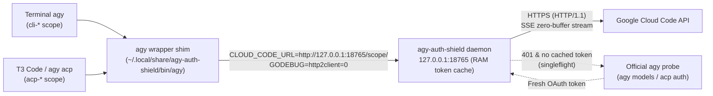

<div align="center">

# agy-auth-shield

**Zero-dependency local OAuth 401 auto-healing gateway for Antigravity CLI (`agy`) & T3 Code.**

[](https://github.com/zs-andy/agy-auth-shield/actions/workflows/ci.yml)
[](LICENSE)
[](#requirements)
[-3776AB.svg)](#requirements)

**English** | [简体中文](README.zh-CN.md)

</div>

---

## The Problem

If you run long agentic turns with **Antigravity CLI (`agy`)** or **T3 Code** (`agy acp`), you have likely hit this abort roughly once an hour:

```text
⚠ UNAUTHENTICATED (code 401): Request had invalid authentication credentials.
Expected OAuth 2 access token, login cookie or other valid authentication credential.

Antigravity stopped this turn because of an error.
```

**Root cause:** Google OAuth2 access tokens expire strictly after **60 minutes**. `agy` captures the current token at the start of a turn; when a long turn crosses the hourly boundary, subsequent Cloud Code API calls still carry the expired token, and `agy` aborts the turn immediately on `401` instead of retrying with a refreshed token. Additionally, terminal `agy` and T3 Code's isolated `agy acp` profile maintain separate credentials and expire on independent schedules.

## What `agy-auth-shield` Does

`agy-auth-shield` installs a lightweight, **100% Python stdlib** loopback gateway (`127.0.0.1:18765`) + non-invasive `agy` wrapper shim:

- **Proactive Stale-Token Swap (0 ms):** When a newer valid token has already been observed in the same credential scope, stale tokens from long-running turns are swapped before reaching Google—zero `401`s ever occur.
- **Two-Tier Reactive 401 Self-Healing:**
  1. **Tier 1 (RAM cache):** Replays the request immediately with another known-good token in the same scope.
  2. **Tier 2 (Singleflight on-demand refresh):** Under a per-scope lock (so concurrent requests trigger only one refresh), invokes official `agy models` (CLI) or `agy acp` `initialize + authenticate` (ACP, never `session/new`) to obtain a fresh token, then replays the exact request seamlessly.
- **Zero-Buffering SSE Streaming:** Server-Sent Events (`text/event-stream`) stream chunk-by-chunk with `TCP_NODELAY`.
- **HTTP/1.1 & Transient EOF Resilience:** Enforces `GODEBUG=http2client=0` for both CLI and T3 Code and automatically retries pre-header transient connection resets once.
- **Strict Scope Isolation:** Isolates terminal CLI (`cli-*`) and each T3 Code / `GEMINI_HOME` profile (`acp-*`) so tokens never cross accounts.
- **Fail-Open & `agy update` Safe:** Leaves `~/.local/bin/agy` untouched so `agy update` works normally, and falls back directly to the real `agy` binary if the daemon is ever unreachable.
- **Zero-Residue Uninstall:** One command removes the daemon, LaunchAgent/systemd service, shell `PATH` blocks, T3 Code override, and installation directory cleanly.

## Architecture



## Quick Install

### One-line install (macOS & Linux)

```bash
curl -fsSL https://raw.githubusercontent.com/zs-andy/agy-auth-shield/main/install.sh | bash
```

Open a new terminal tab (or `source ~/.zshrc` / `source ~/.bashrc`) and verify:

```bash
agy-auth-shield doctor
```

### Install from a local clone

```bash
git clone https://github.com/zs-andy/agy-auth-shield.git
cd agy-auth-shield
./install.sh
```

### Installer options

```bash
# Preview every action without changing anything
./install.sh --dry-run

# Custom port or directory
./install.sh --port 18766 --dir "$HOME/.local/share/agy-auth-shield"

# Also explicitly bind T3 Code settings.json (run when T3 threads are idle)
./install.sh --enable-t3

# Skip editing shell RC files or skip registering background service
./install.sh --no-path --no-service
```

When using `curl | bash`, pass flags via `bash -s --`:

```bash
curl -fsSL https://raw.githubusercontent.com/zs-andy/agy-auth-shield/main/install.sh | bash -s -- --port 18766
```

## T3 Code Activation

T3 Code hot-reloads `~/.t3/userdata/settings.json` and restarts active Antigravity sessions whenever `binaryPath` changes. To avoid interrupting in-flight turns during installation, `install.sh` does **not** edit `settings.json` unless `--enable-t3` is passed.

Choose either method:

1. **Explicit binding (recommended, run when all T3 threads are idle):**
   ```bash
   agy-auth-shield enable-t3
   ```
   *(Or set `Settings → Providers → Antigravity → Binary path` in T3 Code to `~/.local/share/agy-auth-shield/bin/agy`.)*
2. **Zero-config PATH inheritance:** Simply restart T3 Code once after installation; it inherits the updated `PATH` from your login shell profile.

## CLI Reference

| Command | Description |
| --- | --- |
| `agy-auth-shield status` | Human-readable dashboard: daemon uptime, 401s prevented, active scopes, PATH & T3 status |
| `agy-auth-shield status --json` | Machine-readable JSON status payload |
| `agy-auth-shield doctor` | Full self-check: Python/OpenSSL, real `agy`, `PATH` precedence, permissions, log hygiene, T3 Code |
| `agy-auth-shield logs [N \| -f]` | Show last `N` lines of `shield.log` (default 40) or tail live with `-f` |
| `agy-auth-shield start \| stop \| restart` | Control the background `launchd` / `systemd --user` service |
| `agy-auth-shield enable-t3 [--yes]` | Idempotently bind T3 Code's `binaryPath` (backs up to `$SHIELD_HOME/backups/`) |
| `agy-auth-shield disable-t3` | Cleanly remove the `agy-auth-shield` `binaryPath` override from T3 Code |
| `agy-auth-shield upgrade [--ref <ref>]` | Upgrade in-place from GitHub without disrupting T3 Code settings |
| `agy-auth-shield uninstall [flags]` | **Complete zero-residue uninstall** (`--yes`, `--keep-logs`, `--keep-t3`) |
| `agy-auth-shield version` | Print installed version |

### Environment variables

| Variable | Default | Purpose |
| --- | --- | --- |
| `AGY_AUTH_SHIELD_DISABLE` | `0` | Set to `1` to bypass the gateway for a single command (`AGY_AUTH_SHIELD_DISABLE=1 agy ...`) |
| `AGY_AUTH_SHIELD_PORT` | `18765` | Override daemon loopback port |
| `AGY_AUTH_SHIELD_HOME` | `~/.local/share/agy-auth-shield` | Override installation & runtime directory |
| `AGY_AUTH_SHIELD_REAL_AGY` | *(auto-detected)* | Explicitly point wrapper to the underlying `agy` binary |
| `AGY_AUTH_SHIELD_NO_AUTOSTART` | `0` | Set to `1` to disable automatic daemon startup on `agy` invocation |

## Complete Zero-Residue Uninstall

```bash
agy-auth-shield uninstall
```

Or run the standalone remote uninstaller (works even if you removed files manually):

```bash
curl -fsSL https://raw.githubusercontent.com/zs-andy/agy-auth-shield/main/uninstall.sh | bash
```

What gets cleanly removed:
- Stops the daemon and removes the macOS `LaunchAgent` (`~/Library/LaunchAgents/io.github.zs-andy.agy-auth-shield.plist`, plus any legacy `com.*.agy-auth-shield.plist`) or Linux `systemd --user` unit (`~/.config/systemd/user/agy-auth-shield.service`).
- Restores `~/.t3/userdata/settings.json` if `binaryPath` points to `agy-auth-shield` (never touches custom user overrides).
- Strips only the managed `# >>> agy-auth-shield initialize >>>` blocks (and legacy blocks) from `~/.zshrc`, `~/.zprofile`, `~/.bashrc`, `~/.bash_profile`, `~/.profile`, and `~/.config/fish/config.fish` while preserving all your own config.
- Deletes `~/.local/share/agy-auth-shield` completely (pass `--keep-logs` to retain `*.log`).

## Security & Privacy

See [SECURITY.md](SECURITY.md) for the full threat model. Key guarantees:

- **Loopback only:** Binds exclusively to `127.0.0.1` (never `0.0.0.0`).
- **RAM-only tokens:** Observed OAuth Bearer tokens live strictly in process memory—never written to disk, config files, or logs.
- **No direct credential scraping:** Never reads macOS Keychain or T3 Code credential stores directly; delegates refresh exclusively to the official `agy` binary.
- **Authenticated control API:** Control routes (`/__status`, `/__register`, `/__reset_scope`, `/__shutdown`) require a per-install 256-bit random token stored at `0600` inside a `0700` directory.
- **Real logout respected:** If your Google session is genuinely logged out or revoked, Google's original `401` is passed through faithfully with a 20-second probe cooldown.

## Requirements

- **OS:** macOS (`launchd`) or Linux (`systemd --user` or background daemon fallback)
- **Runtime:** Python 3.9+ (standard library only, zero `pip` packages) and `curl`
- **Antigravity CLI (`agy`)** installed (e.g., `~/.local/bin/agy`)

## Testing

```bash
# Run all isolated daemon + install/uninstall zero-residue tests (no network needed)
python3 -m unittest discover -s tests -p "test_*.py" -v

# Optional: run live end-to-end verification against your active signed-in `agy`
python3 tests/live_e2e.py
```

## Disclaimer

This is an unofficial community tool and is not affiliated with or endorsed by Google or Antigravity.

## License

[MIT](LICENSE)
