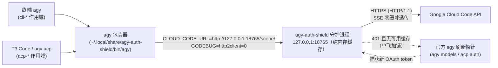

<div align="center">

# agy-auth-shield

**零外部依赖的本地 OAuth 401 无感自愈网关，专为 Antigravity CLI (`agy`) 与 T3 Code 设计。**

[](https://github.com/zs-andy/agy-auth-shield/actions/workflows/ci.yml)
[](LICENSE)
[](#环境要求)
[-3776AB.svg)](#环境要求)

[English](README.md) | **简体中文**

</div>

---

## 解决什么问题

使用 **Antigravity CLI (`agy`)** 或在 **T3 Code**（`agy acp`）里执行长回合任务时，每隔约一小时就会遇到如下中断：

```text
⚠ UNAUTHENTICATED (code 401): Request had invalid authentication credentials.
Expected OAuth 2 access token, login cookie or other valid authentication credential.

Antigravity stopped this turn because of an error.
```

**根因**：Google OAuth2 access token 严格 **60 分钟**过期。`agy` 在一轮 turn 开始时捕获当时的 token，当长 turn 跨过每小时过期边界时，后续请求仍携带旧 token 发往 Google；收到 `401` 后 `agy` 不会刷新重发，而是直接中止当前回合。同时，终端 `agy` 与 T3 Code 隔离的 `agy acp` 使用两套独立凭据，会在各自的时间点分别触发 401。

## 核心特性

`agy-auth-shield` 通过一个**纯 Python 标准库**的本地回环网关（`127.0.0.1:18765`）+ 非侵入式 `agy` 包装器彻底解决该问题：

- **主动替换旧 Token（0ms 无感）**：同一作用域内一旦观测到更新的有效 token，长回合再发旧 token 时在发出前直接替换，根本不触发 401。
- **两级 401 被动自愈**：
  1. **一级（内存缓存）**：同作用域存在其它有效 token 时立即原样重放请求。
  2. **二级（单飞按需刷新）**：同作用域加锁单飞（多路并发 401 只触发一次刷新），调用官方 `agy models`（CLI）或 `agy acp` 的 `initialize + authenticate`（ACP，不创建多余会话），拿到新 token 后无缝重放原请求。
- **SSE 零缓冲实时透传**：流式输出（`text/event-stream`）逐块直通并启用 `TCP_NODELAY`，不增加延迟。
- **HTTP/1.1 + 瞬断重试**：同时对 CLI 与 T3 Code 强制 `GODEBUG=http2client=0`，并对响应头前的瞬时断连（EOF/Reset）自动重试一次。
- **凭据作用域严格隔离**：按 `mode | GEMINI_HOME | app_data_dir | storage` 哈希隔离终端 `cli-*` 与 T3 Code `acp-*`，绝不串号；守护进程重启后自动恢复非敏感作用域元数据。
- **Fail-Open 且兼容 `agy update`**：不改动原版 `~/.local/bin/agy`，官方自动升级完全不受影响；守护进程不可达时自动降级直连原版 `agy`。
- **一键彻底卸载（零残留）**：自动停止守护进程、删除开机自启服务、清除 Shell 配置文件中的 `PATH` 块、还原 T3 Code 设置并删除整个安装目录。

## 工作原理



## 快速安装

### 一键远程安装（macOS & Linux）

```bash
curl -fsSL https://raw.githubusercontent.com/zs-andy/agy-auth-shield/main/install.sh | bash
```

新开一个终端标签页（或执行 `source ~/.zshrc` / `source ~/.bashrc`），运行自检确认一切正常：

```bash
agy-auth-shield doctor
```

### 从本地仓库安装

```bash
git clone https://github.com/zs-andy/agy-auth-shield.git
cd agy-auth-shield
./install.sh
```

### 常用安装参数

```bash
# 仅预览将执行的操作，不改动任何文件
./install.sh --dry-run

# 自定义端口或安装目录
./install.sh --port 18766 --dir "$HOME/.local/share/agy-auth-shield"

# 同时写入 T3 Code 的 settings.json（请在 T3 线程均空闲时使用）
./install.sh --enable-t3

# 跳过修改 Shell 配置或跳过注册后台常驻服务
./install.sh --no-path --no-service
```

通过 `curl | bash` 传参时使用 `bash -s --`：

```bash
curl -fsSL https://raw.githubusercontent.com/zs-andy/agy-auth-shield/main/install.sh | bash -s -- --port 18766
```

## T3 Code 激活方式

T3 Code 会热监听 `~/.t3/userdata/settings.json`，修改 `binaryPath` 会立即重启当前活跃的 Antigravity 会话。因此默认安装不会强行改写该文件，你可以二选一：

1. **显式绑定（推荐，等 T3 当前线程全部空闲时运行）**：
   ```bash
   agy-auth-shield enable-t3
   ```
   （或在 T3 Code `Settings → Providers → Antigravity → Binary path` 填入 `~/.local/share/agy-auth-shield/bin/agy`。）
2. **免配置自动继承**：安装后重启一次 T3 Code，即可自动继承登录 Shell 的新 `PATH`。

## 常用命令

| 命令 | 说明 |
| --- | --- |
| `agy-auth-shield status` | 查看守护进程运行状态、401 拦截/自愈统计、活跃作用域与入口状态 |
| `agy-auth-shield status --json` | 输出 JSON 格式状态（方便脚本集成） |
| `agy-auth-shield doctor` | 全量诊断：Python/OpenSSL、原版 `agy`、`PATH` 优先级、权限、日志脱敏、T3 集成 |
| `agy-auth-shield logs [N \| -f]` | 查看最近 `N` 行日志（默认 40）或使用 `-f` 实时跟踪 |
| `agy-auth-shield start \| stop \| restart` | 启动 / 停止 / 重启后台常驻服务（macOS `launchd` / Linux `systemd --user`） |
| `agy-auth-shield enable-t3 [--yes]` | 幂等写入 T3 Code `binaryPath`（自动备份至安装目录内 `backups/`） |
| `agy-auth-shield disable-t3` | 仅移除由 `agy-auth-shield` 写入的 `binaryPath` 覆盖 |
| `agy-auth-shield upgrade [--ref <ref>]` | 从 GitHub 原地升级（保留配置，不触发 T3 重载） |
| `agy-auth-shield uninstall [参数]` | **一键零残留彻底卸载**（支持 `--yes`、`--keep-logs`、`--keep-t3`） |
| `agy-auth-shield version` | 查看当前安装版本 |

### 环境变量

| 变量 | 默认值 | 用途 |
| --- | --- | --- |
| `AGY_AUTH_SHIELD_DISABLE` | `0` | 设为 `1` 可单次绕过网关直连原版 `agy`（`AGY_AUTH_SHIELD_DISABLE=1 agy ...`） |
| `AGY_AUTH_SHIELD_PORT` | `18765` | 覆盖本地监听端口 |
| `AGY_AUTH_SHIELD_HOME` | `~/.local/share/agy-auth-shield` | 覆盖安装与运行时目录 |
| `AGY_AUTH_SHIELD_REAL_AGY` | *自动探测* | 手动指定原版 `agy` 可执行文件路径 |
| `AGY_AUTH_SHIELD_NO_AUTOSTART` | `0` | 设为 `1` 时若守护进程未启动则直接 fail-open，不自动拉起 |
| `AGY_AUTH_SHIELD_NO_SERVICE` | `0` | 设为 `1` 时跳过所有 `launchctl` / `systemctl --user` 服务操作（`install.sh --no-service` 会自动写入） |
| `AGY_AUTH_SHIELD_GZIP_REQUESTS` | `1` | 对 `>= 16 KiB` 的未压缩 JSON 请求体透明启用 gzip 压缩（遇 `415` 自动降级并关闭）；设为 `0` 可禁用 |
| `AGY_AUTH_SHIELD_WRITE_TIMEOUT_SEC` | `30` | 上游分块上传的单块写卡死超时（秒） |
| `AGY_AUTH_SHIELD_READ_TIMEOUT_SEC` | `600` | 上游响应头与 SSE 空闲读超时（秒） |
| `AGY_AUTH_SHIELD_VALID_TOKEN_TTL_SEC` | `3300` | 内存缓存中有效 token 参与主动替换与一级缓存重放的最大存活时间（秒） |

## 一键彻底卸载（零残留）

```bash
agy-auth-shield uninstall
```

或者直接执行独立远程卸载脚本（即使你之前手动删过部分文件也能清理干净）：

```bash
curl -fsSL https://raw.githubusercontent.com/zs-andy/agy-auth-shield/main/uninstall.sh | bash
```

完整卸载会自动清理以下全部内容：
- 优雅停止守护进程，移除 macOS `LaunchAgent`（`~/Library/LaunchAgents/io.github.zs-andy.agy-auth-shield.plist` 及任何旧版 `com.*.agy-auth-shield.plist`）或 Linux `systemd --user` 服务（`~/.config/systemd/user/agy-auth-shield.service`）。
- 还原 `~/.t3/userdata/settings.json` 中由本工具写入的 `binaryPath`（不会动你自己配置的其它路径）。
- 精准移除 `~/.zshrc`、`~/.zprofile`、`~/.bashrc`、`~/.bash_profile`、`~/.profile`、`~/.config/fish/config.fish` 中的受管区块（以及旧版注释块），完整保留你原有的 Shell 配置。
- 彻底删除 `~/.local/share/agy-auth-shield` 目录（如需保留日志可加 `--keep-logs`）。

## 安全与隐私保障

完整威胁模型见 [SECURITY.md](SECURITY.md)。核心原则：

- **仅绑定本地回环**：严格监听 `127.0.0.1`，不对外网或局域网暴露端口。
- **零凭据落盘**：所有 OAuth Bearer token 仅保存在守护进程内存中，绝不写入磁盘、配置文件或日志。
- **不直接读取敏感存储**：不碰 macOS Keychain 或 T3 Code 凭据文件，刷新完全通过官方 `agy` 公开接口完成。
- **控制接口密钥鉴权**：`/__status`、`/__register`、`/__reset_scope`、`/__shutdown` 均要求 `0600` 权限的 256-bit 随机密钥（存于 `0700` 目录）。
- **真实登出不死循环**：若账号确实已登出或凭据被吊销，原样透传 Google 的 `401` 并进入 20 秒探针冷却期。

## 环境要求

- **操作系统**：macOS（`launchd`）或 Linux（`systemd --user` 或后台守护进程）
- **运行环境**：Python 3.9+（仅使用标准库，无需安装任何第三方依赖）与 `curl`
- **Antigravity CLI (`agy`)**（通常位于 `~/.local/bin/agy`）

## 运行测试

```bash
# 运行隔离集成测试 + 假 $HOME 下的安装/零残留卸载全生命周期测试（无需联网）
python3 -m unittest discover -s tests -p "test_*.py" -v

# 可选：在已登录 agy 的机器上运行实网端到端验证
python3 tests/live_e2e.py
```

## 免责声明

本项目为非官方社区工具，与 Google 或 Antigravity 官方无关。

## 开源协议

[MIT](LICENSE)
